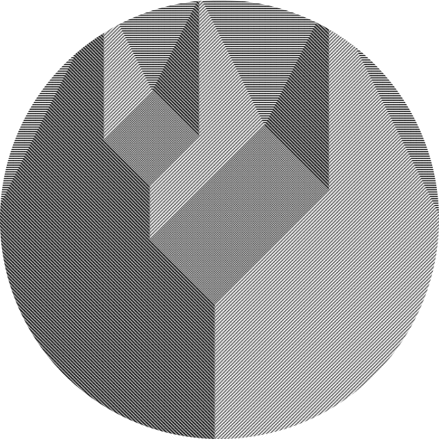

# Celite

# Table of Contents

- [Table of Contents](#table-of-contents)
- [Description](#description)
- [Features](#features)
- [Tech Stack](#tech-stack)

# Description

Designed for Salisbury Mathematics Department and done in an Agile Work environment Celite is a collection Cellular Automata Simulators. The simulations provide accurate fast mathematical creations and includes a parallel updated Wolfram's nearest neighbor, Game of Life, and sequentially updated Wolfram's nearest neighbor.

# Features

- Parallized Wolfram's nearest neighbor
- Sequential Wolfram's nearest neighbor
- Game of Life
- Extensive Documentation
- Friendly UI
- Optimized Performance
- Simple usage

# Tech Stack

- HTML
- Javascript
- CSS
- JQuery

