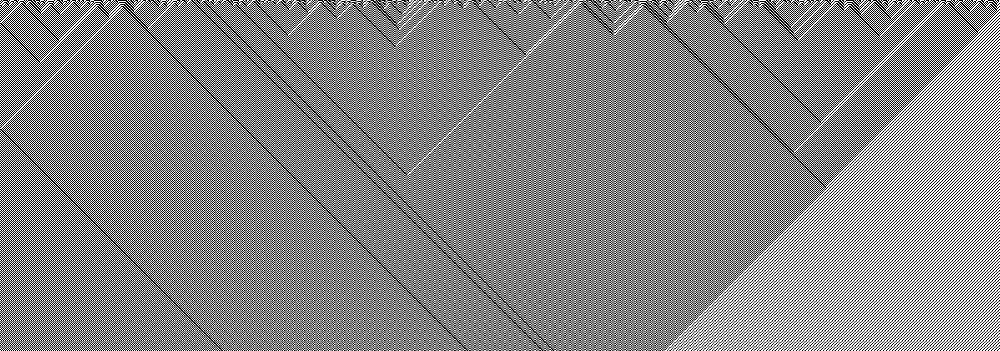

# Celite

**Browser-based cellular automata simulators: an educational and research tool for discrete mathematics.**

[Live site: celite.org](https://celite.org) · [Documentation](https://celite.org/documentation.html)



Celite is a web application with three cellular automaton simulators:

- Parallel Wolfram's Nearest Neighbor
- Sequential Wolfram's Nearest Neighbor
- Conway's Game of Life

It was built for Dr. Michael Bardzell of Salisbury University's Mathematics Department, whose research focuses on discrete mathematical systems, to support his book and his research. It lets students and researchers explore emergent behavior, self-organization and pattern formation in cellular automata.

The project ran for two semesters, in Salisbury University's COSC 425/426 (Software Engineering I/II) sequence. A three-person team built it under Agile/Scrum, with the professor as our client. It was presented at the Salisbury University Student Research Conference (SUSRC) in April 2025.

## Simulators

### Parallel Wolfram's Nearest Neighbor (1D)

Every cell in a one-dimensional lattice updates at the same time. Each cell's next state comes from its own state and its two neighbors, under any of Wolfram's 256 elementary rules (0–255).

- **Boundary conditions:**
  - **Infinite:** the lattice grows left and right as the pattern spreads, up to 3,500 iterations.
  - **Finite, periodic:** the edges wrap around.
  - **Finite, null:** cells beyond the edges count as dead.
- Lattices of up to 1,000 cells and up to 9,000 iterations.

### Sequential Wolfram's Nearest Neighbor (1D)

Uses the same rules, but cells update one at a time in an order you choose, which produces very different patterns from the parallel model.

- **Setup mode:** click or drag across the lattice to set the update order cell by cell.
- **Ordering library:** preset orders such as left-to-right, right-to-left, center-outward and edges-inward, each with a reverse version.

### Conway's Game of Life (2D)

The classic two-dimensional automaton, on a large zoomable grid.

- **Pattern library:** gliders, oscillators and other well-known configurations (101, 119P4H1V0, 1234, 295P5H1V1, 4 gliders to 5 gliders, 60P312, AK94, Snail, Trigger, Tubstretcher).
- **Drawing:** click or drag to draw cells, with adjustable zoom and playback speed.

### Shared features

- **Playback:** step through iterations with an adjustable delay (0–2,000 ms), or compute every iteration at once.
- **Editing:** click to toggle cells; fill the starting lattice completely or randomly; zoom with the scroll wheel; show a hover readout of iteration and cell index.
- **Customization:** pick colors for alive and dead cells and for cell borders, and toggle borders on or off.
- **Export:** download the whole canvas as a PNG or PDF, named after the run's parameters (for example `ParallelWNNI500R30L200.png`: iterations, rule, lattice size).
- **Log box:** reports every action and explains invalid input.
- **Keyboard shortcuts:** nearly every control has one (`Alt` plus a key).
- **In-app guides:** an About panel on each simulator, plus a [full documentation page](https://celite.org/documentation.html) covering each toolbar, the algorithms, and FAQs.

## Tech stack

- **Languages:** vanilla JavaScript (ES modules), HTML5 Canvas and CSS. The simulators use no framework.
- **Libraries:** jQuery (UI wiring) and jsPDF (PDF export).

The code is split into the same four modules for each simulator:

| Module | Role |
|---|---|
| `cellClass.js` | Cell state and drawing |
| `generateLattice.js` | Lattice construction and the update rules |
| `displayLattice.js` | Canvas rendering, zoom and scrolling |
| `UIFunctionality.js` | Toolbars, input checks, shortcuts and export |

## Repository structure

```
├── index.html            # Home page
├── wolframPR.html        # Parallel Wolfram's Nearest Neighbor simulator
├── wolframSQ.html        # Sequential Wolfram's Nearest Neighbor simulator
├── conway.html           # Game of Life simulator
├── documentation.html    # Full user documentation
├── about.html            # Team and acknowledgements
├── js/
│   ├── wolframPR/        # cellClass, generateLattice, displayLattice, UIFunctionality, logClass
│   ├── wolframSQ/        # same layout, plus setup mode and the ordering library
│   ├── conway/           # cellClass, generateLattice, displayLattice, UIFunctionality, plus presets.js (pattern library)
│   └── documentation/
├── styles/               # One stylesheet per page, plus global.css
└── images/               # Preset thumbnails, logos and team photos
```

## Running locally

The scripts are ES modules, so the pages need to be served over HTTP; opening them from the file system won't work. From the repository root:

```bash
python3 -m http.server 8000
# then open http://localhost:8000
```

There is no build step and nothing to install.

## Team

| Name | Role |
|---|---|
| [Kyle Tranfaglia](https://github.com/ktranfaglia1) | Team lead and product manager. Ran meetings and the client relationship, set direction from the client's needs, planned sprints, assigned tasks, merged code and tested. Owned all UI/UX and front-end work, and built back-end simulation logic. |
| [Timothy McKirgan](https://github.com/TimothyJMcKirgan) | Back-end developer |
| [Dustin O'Brien](https://github.com/Omniladder) | Back-end developer |

The project was supported and directed by **Dr. Michael Bardzell**, Salisbury University.
